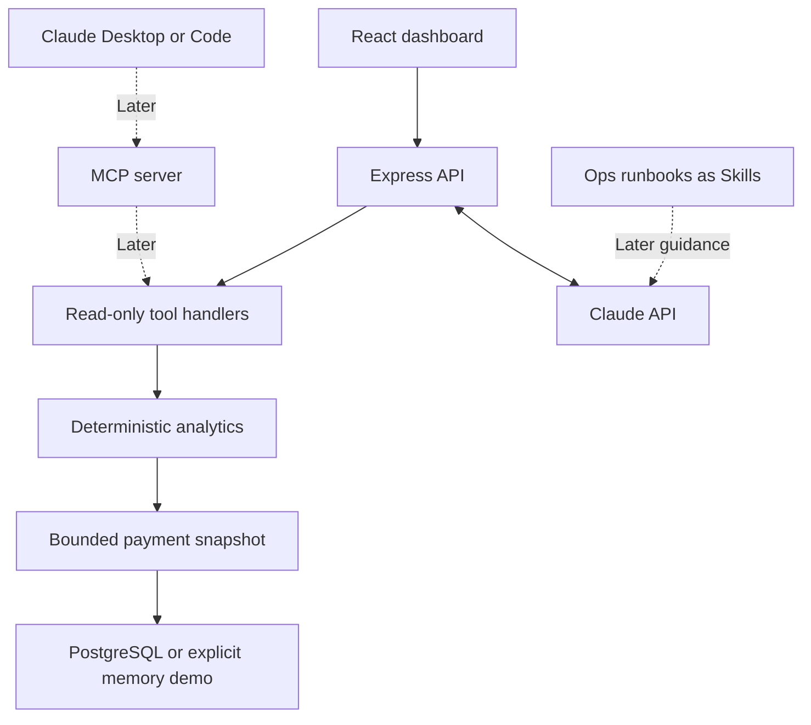

# Payment Ops Assistant


A payment operations dashboard and **Ops Copilot** built with **React, TypeScript, Node.js, Express, Prisma 7, PostgreSQL, and the Claude API**.

Upload a synthetic CSV, ask about a failure spike or possible duplicates, and inspect the backend evidence behind the answer. Claude chooses read-only tools and explains their results; deterministic code calculates counts, rates and monetary totals.

**Synthetic data only.** This is a local, single-user portfolio demo. It has no payment execution capabilities and no production authentication. Do not upload real customer or payment data.

[Ops Copilot setup, learning walkthrough and evaluation guide](docs/ops-copilot.md)

The application simulates the type of internal tooling used by payment operations teams to import transaction exports, validate data quality, monitor processing metrics, and investigate failed imports.

Rather than focusing on CRUD functionality, this project demonstrates backend architecture, validation pipelines, data persistence, and frontend dashboard development commonly found in fintech systems.

---

# ✨ Features

- CSV transaction import
- Comprehensive row-level validation
- Import history
- Currency-separated dashboard analytics
- Claude tool-use investigation loop with streamed progress
- Exact monetary totals and evidence references
- Rule-based duplicate candidates and daily failure spikes
- Structured findings for human review
- Ten-question evaluation set (offline oracles and optional live model evals)
- Transaction search
- Filtering
- Sorting
- Server-side pagination
- Row-level validation errors
- PostgreSQL persistence
- Automatic in-memory fallback when the database is unavailable

---

# 🛠 Tech Stack

## Frontend

- React
- TypeScript
- Vite
- CSS

## Backend

- Node.js
- Express
- TypeScript

## Database

- PostgreSQL
- Prisma ORM

## File Uploads

- Multer

---

# 🏗 Architecture



The API streams investigation steps over SSE and sends the completed report after validation. Numeric placeholders are filled from tool facts. Structured findings and transaction evidence come directly from backend rules. Qualitative interpretation still requires review; a valid JSON schema does not establish factual truth.

MCP, Agent Skills and Claude Code workflow additions are later course milestones. The current implementation contains the analytics foundation and Claude API milestone.

---

# 📥 Import Workflow

```
Upload CSV
      │
      ▼
Validate File
      │
      ▼
Parse CSV
      │
      ▼
Validate Every Row
      │
      ├── Valid → Transaction
      │
      └── Invalid → ImportError
      │
      ▼
Update Import Summary
      │
      ▼
Dashboard & Import History
```

Every upload is tracked as an Import.

Each invalid row is stored independently with the row number and validation reason, allowing failed records to be reviewed without losing successful transactions.

---

# ✅ Validation Rules

The import pipeline validates:

- Required columns
- Duplicate transaction IDs
- Existing transaction IDs
- Invalid currencies
- Invalid payment statuses
- Invalid dates
- Negative amounts
- Empty files
- Non-CSV uploads
- Maximum file size
- Incorrect column counts

Validation errors are reported per row instead of failing the entire import.

---

# 📊 Dashboard

The dashboard provides operational metrics including:

- Total transactions
- Successful transactions
- Pending transactions
- Failed transactions
- Successful processed amounts grouped by currency
- Success rate

These metrics are aggregated by the backend rather than calculated on the client.

---

# 🔍 Transactions

The transaction view supports:

- Server-side pagination
- Debounced search
- Status filtering
- Currency filtering
- Date range filtering
- Sortable columns

This keeps the frontend lightweight while allowing the backend to handle querying and aggregation.

---

# 📜 Import History

Every upload generates an Import record containing:

- Filename
- Import status
- Processing time
- Total rows
- Successful rows
- Failed rows

Failed rows include detailed validation messages for troubleshooting.

---

# 🏛 Engineering Decisions

## Repository Pattern

Query and aggregation logic is isolated into repository classes.

This keeps Express route handlers focused on request handling while allowing data access to evolve independently.

---

## Prisma Driver Adapter

The project uses the Prisma 7 driver adapter (`@prisma/adapter-pg`) rather than relying on legacy Prisma connection configuration.

---

## Allow-List Validation

Currencies and statuses are validated against explicit allow-lists instead of accepting arbitrary strings.

This mirrors how production payment systems typically validate financial data.

---

## Graceful Database Fallback

If PostgreSQL is unavailable, the API automatically switches to an in-memory repository.

Although this introduces duplicated repository logic, it allows the application to remain functional during demonstrations without requiring a running database.

---

# ⚡ Trade-offs

Several implementation choices were made intentionally.

### No React Router

Navigation is implemented using component state.

For this small dashboard this keeps routing simple while avoiding unnecessary dependencies.

A larger application would benefit from route-based navigation.

---

### Custom CSV Parsing

The parser is implemented manually instead of using a dedicated CSV parsing library.

While sufficient for this project, production systems would likely rely on a mature parser to handle additional edge cases.

---

### API Configuration

The frontend uses `VITE_API_URL`, defaulting to `http://localhost:3001`. Claude credentials stay on the API server. The local API binds to loopback by default. Public hosting requires authentication, authorization, tenant isolation and shared rate/cost controls.

---

### In-Memory Repository

Supporting both PostgreSQL and in-memory repositories increases code duplication.

The trade-off is improved demo resilience when a database isn't available.

---

# 📂 Project Structure

```text
apps/api/src/           Express, CSV imports and repositories
apps/api/src/ops/       Analytics rules, tool schemas, Claude loop and SSE route
apps/api/evals/         Ten questions, expected facts and optional live runner
apps/web/src/           React dashboard and Ops Copilot panel
prisma/                Schema and versioned migrations
sample-data/           Synthetic CSV fixtures
docs/                  Architecture and learning walkthrough
```

---

# 🚀 Getting Started

## Prerequisites

- Node.js 24+ (CI also tests the configured Node version)
- PostgreSQL for persistence, or omit `DATABASE_URL` for the in-memory demo
- An Anthropic API key, available API credits and a supported model for live investigations

## Install and configure

Run from the repository root:

```bash
npm ci
npm --prefix apps/api ci
npm --prefix apps/web ci
cp .env.example .env
npx prisma generate
```

Set `ANTHROPIC_API_KEY` and `ANTHROPIC_MODEL` in `.env`. Optional `DATABASE_URL` enables persistence. Never commit keys or expose them through `VITE_` variables. If PostgreSQL is configured, apply migrations:

```bash
npx prisma migrate deploy
```

The amount migration rejects values that would need silent rounding. Review synthetic data before migrating an existing database.

## Run

```bash
# Terminal 1
cd apps/api
npm run dev
```

```bash
# Terminal 2, from the repository root
npm --prefix apps/web run dev
```

Open the frontend, upload `sample-data/ops-copilot-synthetic.csv`, and choose **Ops Copilot → Failure investigation**. Without a configured key/model, the dashboard still works and Copilot reports its missing configuration.

## Verify

```bash
npm --prefix apps/api test
npm --prefix apps/api run build
npm --prefix apps/api run eval
npm --prefix apps/web test
npm --prefix apps/web run lint
npm --prefix apps/web run build
```

Offline evals verify deterministic expected facts. To evaluate actual Claude tool selection and answers (uses API credits):

```bash
npm --prefix apps/api run eval:live -- --output ../../ops-eval-results.json
```

Review the qualitative rubric as well as automated assertions. Live model results are not claimed until that run has completed.

---

# 📡 API Endpoints

| Method | Endpoint | Purpose |
|---------|----------|----------|
| GET | `/health` | Health check |
| POST | `/api/imports` | Upload CSV |
| GET | `/api/imports` | Import history |
| GET | `/api/imports/:id` | Import details |
| GET | `/api/transactions` | Transactions |
| GET | `/api/transactions/summary` | Dashboard metrics by currency |
| POST | `/api/ask` | Stream investigation progress and a validated report |

---

# 🚀 Next Course Milestones

1. **MCP:** share the existing handlers through an MCP server with a dedicated read-only DB role.
2. **Agent Skills:** package failed-payment triage and batch-reconciliation runbooks.
3. **Claude Code:** add project conventions and a custom command; document what was directed and reviewed.

Before public hosting: authentication/authorization, tenant-scoped data access, durable usage limits and observability. For larger data: database-level rule aggregations instead of the current bounded snapshot.

---

# 🎯 Why This Project?

Payment operations systems are significantly more than CRUD applications.

This project focuses on the types of engineering challenges commonly encountered in fintech platforms:

- Data validation
- Import pipelines
- Repository architecture
- Dashboard aggregation
- Backend pagination
- Transaction reconciliation
- Error reporting
- Production-oriented API design

The codebase is intentionally structured to demonstrate practical backend and frontend architecture while remaining compact enough to review during technical interviews.