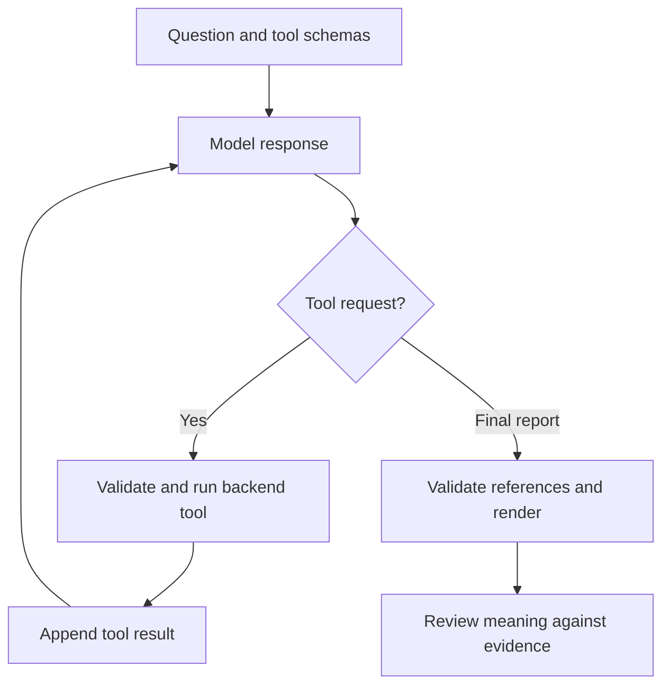

# Lesson 1: explain and validate an agent workflow

Goal: follow a payment investigation through the model boundary, backend tools and final report, then explain what the checks prove. Allow about 30–45 minutes. Stay on the Claude API milestone until you can explain this loop.

## Run it

From the repository root on `feat/ops-copilot-api`:

```bash
npm --prefix apps/api ci
npm --prefix apps/api run learn:agent
```

Use the Node version from the root README. No API key, credits, database, server or uploaded payment data are needed for the lesson. It reads the committed synthetic CSV. Model responses are explicitly scripted; this is a replay of the real application loop, not a demonstration that Claude selected the right tools.

## Predict before you run

Question: **Why did failures spike on 2026-11-10?**

1. Which tool could establish whether a spike occurred?
2. Is a detected spike enough evidence to explain its cause?
3. Which tool could inspect recorded reasons on the affected day?

The replay requests `flag_anomalies`, reads the day from the returned finding, then requests `get_summary` for that day. A live model chooses the requests; this teaching script fixes them so you can study the application mechanics.



## Who does what?

| Responsibility | Owner in this project | Code to read |
| --- | --- | --- |
| Describe available operations and inputs | Developer | `apps/api/src/ops/tools.ts` |
| Choose a tool and its arguments | Claude in live mode; scripted double in this lesson | `Completion` in `copilot.ts` |
| Keep conversation history and enforce budgets | Node.js application | `investigate` in `copilot.ts` |
| Validate arguments and compute payment facts | Backend | `parseScope` and `runAnalytics` in `analytics.ts` |
| Select evidence and write the explanation | Claude in live mode; scripted double in this lesson | Final JSON report |
| Resolve fact IDs to actual values | Backend | `renderReport` in `copilot.ts` |
| Judge whether the conclusion follows from the evidence | Evaluation checks and human reviewer | `evals/cases.ts` and its review rubric |

The loop, allowed tools, state, budgets and validation together form the agent's **harness**: the application code that controls how the model operates. The model requests an operation; it does not directly run a database query.

## Read the trace

| Stage | What you should observe |
| --- | --- |
| First model round | A `tool_use` request for `flag_anomalies` with an exact UTC date range. |
| First backend result | Prior-day failure rate **20%**, affected-day failure rate **60%**, increase **40 percentage points**. |
| Second model round | The first result is present in conversation history, paired with its request ID. The script uses the finding's date to request `get_summary`. |
| Second backend result | **6** failed payments; `issuer_timeout` is recorded for **4**. |
| Third model round | A report template references existing facts, such as `{{e1.rate_2026-11-10}}`. |
| Rendering | The backend inserts the computed values. The explanation says the export does not establish an issuer outage or root cause. |

The replay asserts these expected values and the request/result pairing. Numbers come from the existing analytics, not from the scripted model. In live operation, Claude is subject to the same renderer.

## Break it and understand the limits

The lesson then exercises three deliberately bad reports:

| Report | Observed outcome | What it teaches |
| --- | --- | --- |
| “The failure rate is 99%.” | Rejected | Numeric literals cannot bypass the fact renderer. |
| A `{{made_up.rate}}` reference | Rejected | Reports can only cite evidence actually returned during the investigation. |
| “The success rate is `{{e2.failure_rate}}`.” | **Accepted by the renderer**, but contradicted by the fixture's 40% success rate | A real number can support a misleading sentence. Reference validation is not semantic validation. |

The final example is an intentional demonstration of an existing limitation. It is not displayed in the product UI by this lesson and is not a claim that the system catches all hallucinations. A wrong date filter or an unsupported causal claim can also survive reference checks. Live evaluations and review must check meaning, scope and uncertainty.

## Your exercise

1. Run the lesson and locate the point where the first tool result returns to the model.
2. Open `apps/api/evals/agent-workflow-lesson.ts`. Explain why `readToolResult` checks `tool_use_id`.
3. In a local experiment, change the final `answerTemplate` to claim an issuer outage while keeping valid fact references. Predict whether the renderer rejects it, run it, and restore the original text.
4. Explain aloud: “The model chooses the investigation steps. My backend validates inputs and calculates the facts. The model cites those facts, and my renderer resolves the values. I still evaluate whether the explanation follows from the evidence.”

Move on when you can answer: **Why can a report contain only real numbers and still be wrong?**

## Next learning increments

| Step | Concrete outcome |
| --- | --- |
| Live API run | Run the same question with Claude and inspect actual tool choices and scopes. Requires configured API access and credits. |
| Evaluation | Run `npm --prefix apps/api run eval:live`, then assess each answer using its manual rubric. Record failures as well as passes. |
| Small improvement | Turn an observed failure into a targeted validation rule or eval case and rerun the affected checks. |
| MCP course | Expose the understood and tested tools through MCP. |
| Agent Skills → Claude Code | Add the planned runbooks, then document actual coding-agent usage and review. |

There are two related portfolio stories: the **agent inside the product** investigates payment data; your **agent-assisted development workflow** is how you define a small task, inspect the generated diff, test it, and accept or revise it. This lesson supports the first and supplies a concrete change to review for the second. The implementation history remains attributed to ChatGPT/Codex, not Claude Code.

Official reference: [Anthropic's tool-use contract and loop](https://platform.claude.com/docs/en/agents-and-tools/tool-use/how-tool-use-works).
